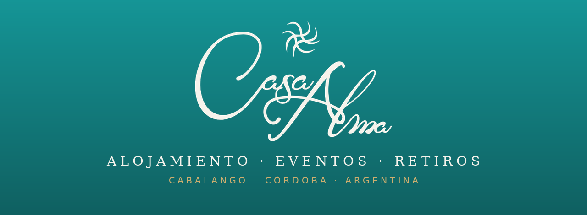
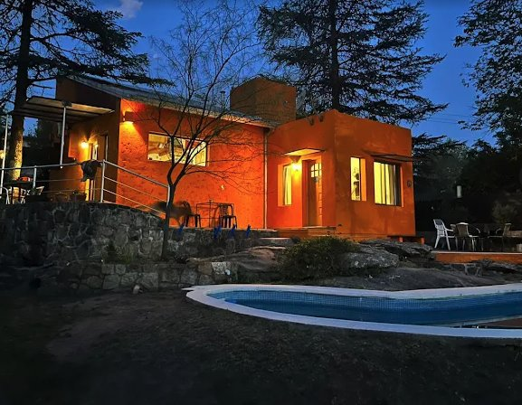
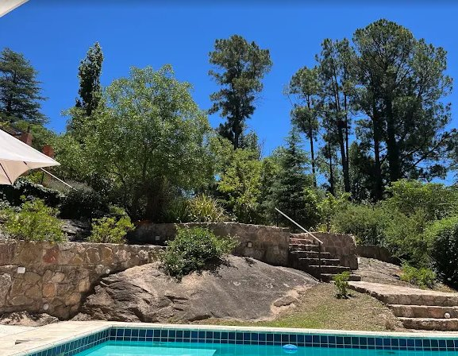
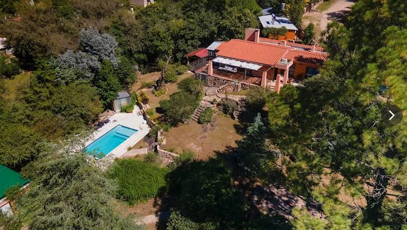
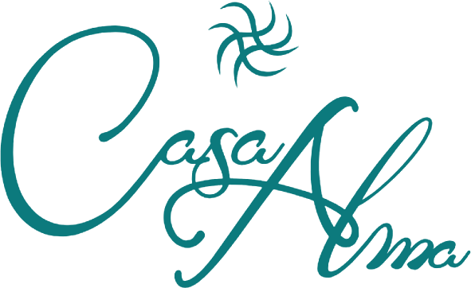

<div align="center">



# Casa Alma · Cabalango

**Un refugio de naturaleza y pileta en las sierras de Córdoba.**
Estadías · Eventos · Retiros

[](https://casalma.netlify.app)
[](https://www.instagram.com/casaalma.cordoba/)
[](https://wa.me/5493515523836)
[](https://www.airbnb.com/rooms/1522539833886487812)

</div>

---

## 🏡 Sobre Casa Alma



**Casa Alma** es un espacio con alma en **Cabalango, Valle de Punilla (Córdoba, Argentina)**, a pocos minutos de Villa Carlos Paz. Rodeada de verde y con la pileta como corazón, combina el confort de un hogar con la calma de las sierras.

Cada ambiente fue pensado para que grupos, familias y equipos encuentren su ritmo: mañanas de sol, tardes de agua y noches de sobremesa. Ya sea para unos días de descanso, una celebración o un retiro de bienestar, la casa se adapta a lo que necesites vivir.


<br clear="right"/>

## ✨ Experiencias

| | |
|---|---|
| 🛏️ **Estadías** | Alquilá la casa por unos días y disfrutá de la pileta, el verde y la tranquilidad. Ideal para familias y grupos de amigos. |
| 🎉 **Eventos** | Cumpleaños, casamientos, celebraciones y jornadas de equipo. *No es solo un salón: es un lugar al servicio de tu vocación.* |
| 🧘 **Retiros** | Yoga, meditación, bienestar y encuentros de formación. La casa se transforma en un espacio de calma para volver a lo esencial. |

<div align="center">


</div>

## 📅 Reservas y contacto

| | |
|---|---|
| 🌐 **Web** | [casalma.netlify.app](https://casalma.netlify.app) |
| 🏠 **Airbnb** | [Reservar en Airbnb](https://www.airbnb.com/rooms/1522539833886487812) |
| 💬 **WhatsApp** | [+54 351 5523836](https://wa.me/5493515523836) |
| ✉️ **Email** | [cabalango.casa.alma@gmail.com](mailto:cabalango.casa.alma@gmail.com) |
| 📸 **Instagram** | [@casaalma.cordoba](https://www.instagram.com/casaalma.cordoba/) |
| 📍 **Dirección** | Calle La Posta S/N, Cabalango, Córdoba, Argentina |

## 💻 Sobre este repositorio

Este repositorio contiene el **sitio web de Casa Alma**: una página única, responsive y bilingüe (español / inglés), construida como sitio estático autónomo.

```
CasaAlmaWeb/
├── index.html        → la web completa (HTML + CSS + JS, con imágenes embebidas)
├── README.md         → este archivo
└── assets/           → logo, banner e imágenes del README
```

**Publicación:** el sitio se publica automáticamente en **[casalma.netlify.app](https://casalma.netlify.app)** vía Netlify. Cada cambio que se sube a este repositorio se despliega solo.

**Para editar contenido rápido** (WhatsApp, links, etc.), buscá el bloque `CONFIG` al final de `index.html`.

---

<div align="center">



**Casa Alma** · Cabalango, Córdoba 🇦🇷
Hecho con alma 💚 · *Proyecto Alma — Rene Boiero*

</div>
